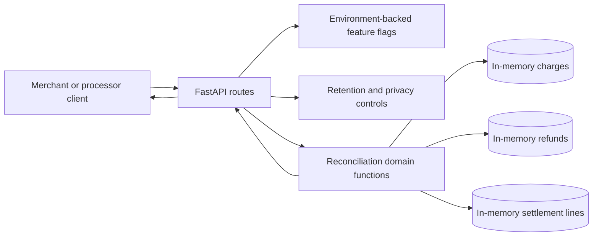
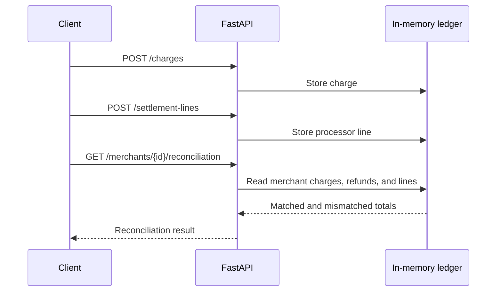

# Service architecture

Meridian Settlement API is a single-process FastAPI service. It exposes charge,
refund, settlement-line, and merchant-reconciliation endpoints. Domain logic
lives in `reconcile.py`; HTTP validation and error translation live in
`main.py`; feature configuration lives in `feature_flags.py`.
`privacy.py` owns retention and admin authorization, while `secret_config.py`
supports environment and mounted-file secret injection.

The current persistence layer is deliberately in-memory. `charges`, `refunds`,
and `settlement_lines` are process-local collections. They are lost on restart
and are not shared between workers, so the service must run as one worker until
a durable store replaces them.



## Reconciliation flow



## External dependencies

The running service calls no database. Optional Sentry and PostHog adapters are
disabled unless credentials are configured. Runtime dependencies are pinned in
`requirements.txt`. GitHub Actions provides CI, security scanning, release
automation, image publication, and automated Droid review.

The committed `openapi.json` is generated from the FastAPI application with:

```bash
PYTHONDONTWRITEBYTECODE=1 python scripts/generate_openapi.py
```
